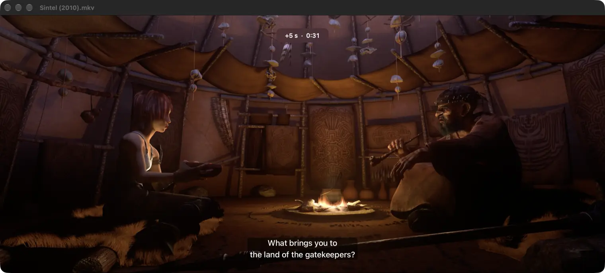

# MKV Player

A small native video player for Mac that opens MKV and WebM files. The app is about 500 KB and the
download is 234 KB.



## Why

the reason i made this was that vlc was 100mb, and in the horrible internet in the train, even that i
was not able to get, and there was no native mkv player for mac, So, i booted up davinci resolve to
watch the video 😂😭. But then it was inconvenient with the controls and no fullscreen, so i just
decided to build one myself

## VLC

VLC is free, made by volunteers, and plays nearly everything. If a file doesn't work here, get
[VLC](https://www.videolan.org/vlc/), and if it helps you out, [donate to
VideoLAN](https://www.videolan.org/contribute.html#money). This app only exists because of one bad
train connection.

## Install

1. Download `MKV-Player.zip` from [Releases](https://github.com/Ad1th/mkv-player/releases) (Apple
   Silicon and Intel). There's also an Apple Silicon-only zip that's half the size.
2. Unzip it and drag **MKV Player** into Applications.
3. Open it once. It isn't from the App Store or notarised by Apple, so macOS stops it the first time:
   - **macOS 15 or later:** click Done. Open System Settings > Privacy & Security, scroll down, click
     **Open Anyway** next to MKV Player, then Open Anyway again and enter your password.
   - **macOS 13 or 14:** right-click the app, choose Open, then click Open.
   - Or in Terminal: `xattr -dr com.apple.quarantine "/Applications/MKV Player.app"`
4. To make it the default for .mkv: right-click any .mkv, Get Info, Open with: MKV Player, Change All.

Needs macOS 13 Ventura or later.

## What it plays

- **Video:** H.264, HEVC (10-bit too), VP9, and AV1 on Macs with an M3 or newer
- **Audio:** AAC, AC-3, E-AC-3, MP3, FLAC, Opus, ALAC, PCM
- **Subtitles:** SRT, ASS/SSA and WebVTT, inside the file or as a separate file next to it (or drop
  one on the window)
- Chapters, MP4 and MOV, and direct links or HLS streams with Open URL

What it doesn't:

- **DTS and TrueHD audio.** The video plays without sound. If you have ffmpeg (`brew install ffmpeg`),
  MKV Player uses it to convert the audio instead.
- **10-bit H.264 (Hi10P)**, which a lot of older anime releases use. macOS has no decoder for it.
- **Picture subtitles** (PGS from Blu-rays, VobSub from DVDs). The rest of the file still plays.
- AVI, WMV and other old formats, unless ffmpeg is installed.

## Keys

Mostly the same as YouTube.

| Key | Does |
|---|---|
| Space or K | Play / pause |
| J / L | Back / forward 10 seconds |
| ← / → | Back / forward 5 seconds |
| ↑ / ↓ | Volume, up to 200% |
| 0 to 9 | Jump to 0%, 10% ... 90% |
| Home / End | Start / end |
| < / > | Slower / faster (0.25x to 2x) |
| , / . | Previous / next frame |
| C | Subtitles on / off |
| V | Next subtitle track |
| B | Next audio track |
| F | Full screen |
| M | Mute |
| N / P | Next / previous file in the folder |
| Shift-N / Shift-P | Next / previous chapter |
| S | Snapshot (saved to Pictures and copied) |
| R | Loop |
| A | A-B loop: press at the start, then at the end |
| Cmd-I | Media info |

It remembers where you stopped in each file, and which audio and subtitle tracks you picked in each
folder, so the next episode starts with the same ones. When a file ends, the next one in the folder
starts.

## How it works

macOS can already decode almost everything inside a typical MKV (H.264, HEVC, AAC, AC-3...). It just
can't read the Matroska container. So MKV Player reads the MKV's structure itself, finds where every
frame sits in the file, and writes a small QuickTime movie whose sample tables point at those byte
offsets in the original MKV. AVFoundation plays that, with hardware decoding and the normal macOS
player controls. Nothing is copied or converted. For a 245 MB episode the reference movie is about
1.5 MB and takes about a third of a second to write. It goes in a temporary folder and gets deleted
when you open the next file or quit.

Text subtitles are turned into QuickTime text tracks in the same small movie.

The parts:

- `EBML.swift`, `Matroska.swift`: a memory-mapped reader for the Matroska format
- `Remuxer.swift`, `MovieWriter.swift`, `SampleEntries.swift`: build the reference movie
- `Subtitles.swift`, `ExternalSubtitles.swift`: subtitle tracks, and .srt/.vtt/.ass files
- `FFmpeg.swift`: the fallback, only used if ffmpeg is already installed
- `AppDelegate.swift`: the window, menus and keys

## Build

Needs the Xcode command line tools (`xcode-select --install`). No Xcode project, no dependencies.

```sh
./build.sh              # Apple Silicon, build/MKV Player.app
./build.sh universal    # Apple Silicon and Intel
```

## Tests

```sh
Tests/run.sh
```

This makes small MKV and WebM files with ffmpeg (every codec in the list above), remuxes each with the
app's code, and decodes every frame of every track through AVFoundation. ffmpeg is only needed for
making the test files.

## License

MIT. See [LICENSE](LICENSE).

The screenshot is from [Sintel](https://durian.blender.org/) © Blender Foundation, CC BY 3.0.
